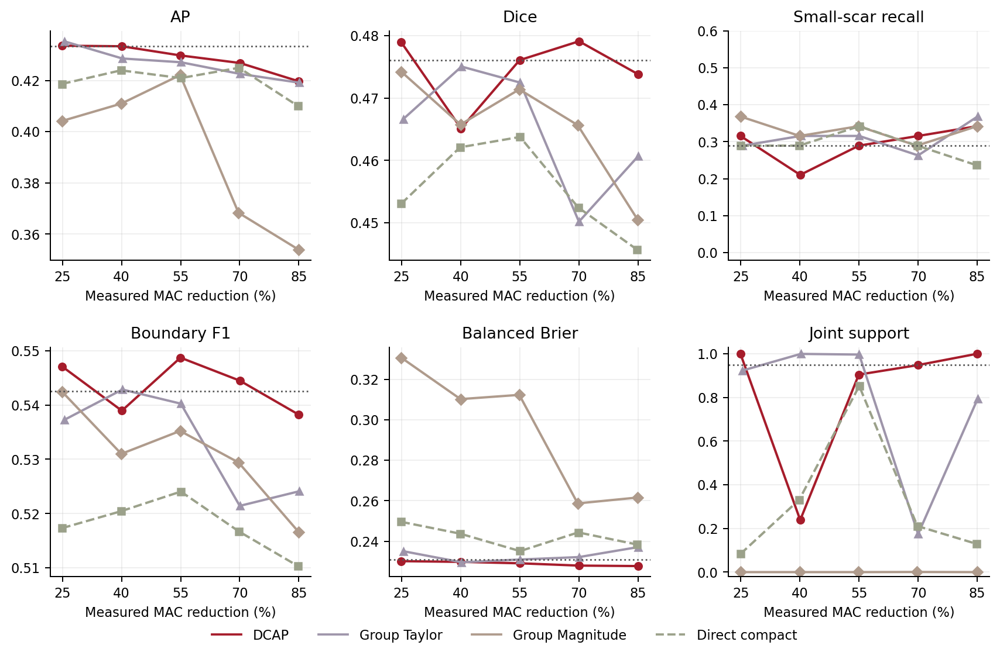

# DCAP for landslide segmentation

**Detail–Context Adaptive Pruning (DCAP)** combines dependency-shared channel gates, physical structured pruning and task-aware recovery. This repository provides code, processed Nepal landslide data, representative checkpoints and evidence for manuscript Figures 6–8 and 10.

[**Code and comparator models: v1.2.0**](https://github.com/ghimiredhikura/DCAP/releases/tag/v1.2.0) · [Setup](docs/setup.md) · [Reproduction](docs/reproduction.md) · [All guides](docs/README.md)

Verified RTX 4080 and Jetson AGX Orin deployment results are included on `main`; the tagged v1.1.0 data/model assets remain unchanged.

## Main results

Retrospective test results for three-model ensembles on withheld locations from 2017–2019. All compressed models use a common 70% target. MAC reduction reports the measured value.

| Model (MAC reduction target) | MAC reduction | AP ↑ | Dice ↑ | Small-scar recall ↑ | Boundary F1 ↑ | Balanced Brier ↓ | Joint support ↑ |
|---|---:|---:|---:|---:|---:|---:|---:|
| Dense reference | 0.00% | 0.4333 | 0.4760 | 0.2895 | 0.5425 | 0.2310 | — |
| DCAP (70%) | 70.03% | 0.4268 | 0.4791 | 0.3158 | 0.5445 | 0.2280 | 0.9484 |
| Group Taylor (70%) | 70.00% | 0.4226 | 0.4502 | 0.2632 | 0.5214 | 0.2322 | 0.1742 |
| Group Magnitude (70%) | 69.69% | 0.3683 | 0.4657 | 0.2895 | 0.5294 | 0.2587 | 0.0006 |
| Direct compact (70%) | 69.82% | 0.4250 | 0.4525 | 0.2895 | 0.5167 | 0.2444 | 0.2109 |

DCAP's test joint support of 0.9484 remains below the specified 0.95 cutoff; the comparison does not establish joint preservation or uniform superiority. Values come from [the compression grid](results/figure6.csv) and [dense results](results/representative.json). All budgets and validation-selected operating points remain in [the complete table](results/operating_points.csv) and [selection results](results/selection.csv).

[](results/figures/figure6.pdf)

**Figure 6.** Compression trade-offs across five targets. Dotted lines show the dense reference, or the 0.95 cutoff for joint support. [PDF](results/figures/figure6.pdf) · [Plot data](results/figure6.csv)

## Deployment results

Complete three-model ensembles, **FP32 CUDA Graphs**, with a common 70% pruning target:

| Device | Batch-one latency, dense → DCAP (ms) | Batch-four throughput, dense → DCAP (chips/s) | Peak allocation, dense → DCAP (MiB) |
|---|---:|---:|---:|
| RTX 4080 | 7.168 → 4.724 | 124.5 → 209.0 | 95.0 → 15.7 |
| Jetson AGX Orin | 38.383 → 25.915 | 28.4 → 43.9 | 95.4 → 15.7 |

TensorRT gives DCAP latencies of **0.967 / 5.914 ms** on RTX 4080 / Orin. Gains depend on the backend: Orin eager-AMP latency is 3.5% higher than dense, and other pruned models can be faster. [Protocol and comparison](docs/benchmark.md) · [Table 13](results/table13.csv) · [Figure 10](results/figures/figure10.pdf)

## Quick start

### 1. Clone and set up

Activate an environment with Python and PyTorch, or follow the [setup guide](docs/setup.md) to create one. Run commands from the repository root.

```bash
git clone https://github.com/ghimiredhikura/DCAP.git
cd DCAP
python -m pip install -e .
python -m pip check
```

### 2. Reproduce plots and statistical summaries

No model or raster downloads are needed. Outputs go to `generated/`.

```bash
python -m dcap verify
python -m dcap plot --figures 6 7 8 10
OPENBLAS_NUM_THREADS=2 python -m dcap replay --grid
```

### 3. Evaluate the released models

Download about **97 MiB of checkpoints** and **3.43 GiB of data**, with checksum verification:

```bash
python -m dcap download --repository ghimiredhikura/DCAP --tag v1.1.0 --kind models --output downloads/models
python -m dcap download --repository ghimiredhikura/DCAP --tag v1.1.0 --kind data --output downloads/data
python -m dcap models install --source downloads/models
python -m dcap data install --source downloads/data
python -m dcap evaluate --ensemble dcap70 --split test
```

For SIRFP/SegFormer checkpoints and reproduction commands, follow the [comparator guide](docs/comparators.md).

Next: [train the main comparison](docs/reproduction.md) or [benchmark an Ubuntu GPU](docs/benchmark.md). Benchmarking needs the model download only.

## Repository guide

| Folder | Contents |
|---|---|
| [`src/dcap/`](src/dcap/) | Shared preparation, training, pruning, inference, analysis and plotting code |
| [`configs/`](configs/) / [`metadata/`](metadata/) | Protocol, fixed splits, source geometries, thresholds and checksums |
| [`results/`](results/) | Figures 6–8 and 10, deployment tables and compact spatial evidence |
| [`data/`](data/README.md) | Small inference fixture and dataset notices; full rasters are release assets |
| [`docs/`](docs/README.md) | Setup, reproduction, data, benchmark and validation guides |

Fifteen checkpoints are available: three members each for dense, DCAP70, SIRFP25, SIRFP70 and SegFormer-B2. The optional [comparator guide](docs/comparators.md) covers their downloads, evaluation and training. Geographic fold retraining remains outside this compact release.

## License and citation

Author code and ResUNet checkpoints use the [MIT license](LICENSE). SegFormer-derived code and weights retain the [NVIDIA Source Code License](licenses/SegFormer-LICENSE.txt) for noncommercial research/evaluation. SIRFP upstream source is obtained separately; see [model notices](licenses/COMPARATOR_MODEL_NOTICES.txt). Dataset components retain their source terms in [DATA_NOTICES](data/DATA_NOTICES.txt). Cite the accompanying manuscript, [this software](CITATION.cff) and the source datasets.
