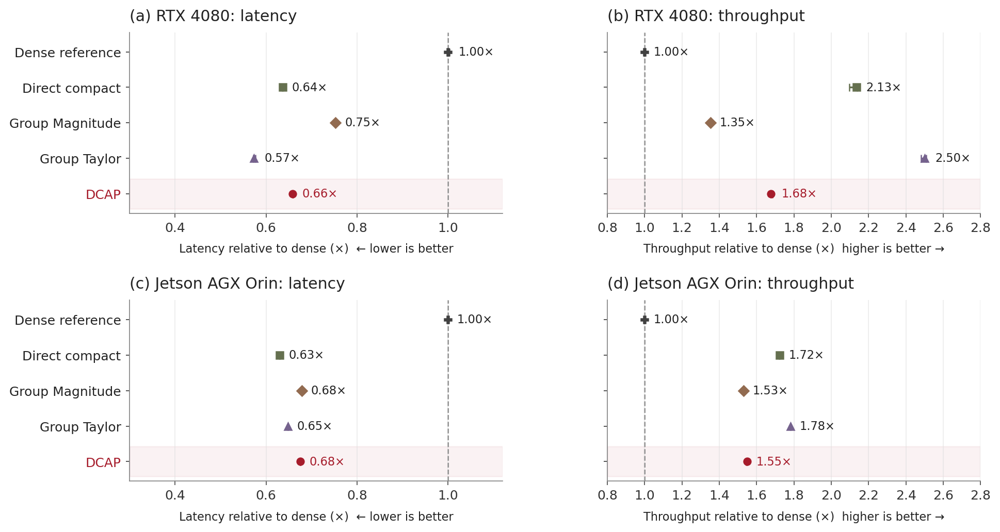

# Deployment results and Ubuntu benchmark


## Measured RTX 4080 / Orin results

[Table 13 CSV](../results/table13.csv) contains absolute latency, throughput and memory; [Figure 10 CSV](../results/figure10.csv) compares five methods at the same approximately 70% target. Group Taylor uses 70%, not its separate validation-selected 85% point. The compact [measurement record](../results/deployment.json) supplies block medians, pooled summaries, source hashes and device settings for these results.

Rebuild both tables and the figure in a CPU environment from [setup](setup.md):

```bash
python -m dcap plot --figures 10 --output generated/deployment
```

Outputs: `figure10.pdf`, `figure10.png`, `figure10.csv` and `table13.csv`.

[](../results/figures/figure10.pdf)

- **Timing:** three forwards, sigmoid and FP32 probability averaging on GPU-resident input. Batch one for latency/memory; batch four for throughput. Loading, preprocessing, transfers and graph capture/engine building are excluded.
- **Summary:** Table 13 uses pooled-sample medians. Figure 10 uses the median/range of three block medians, normalized by the dense center. Bars show timing variation, not predictive uncertainty.
- **Memory:** PyTorch peak allocation (AMP), allocated/reserved peaks (FP32 graphs), or native TensorRT context memory. These differ and are not total device memory.
- **Interpretation:** compare models within the same device/backend. Software differs between devices; faster GPU performance cannot be inferred from their names alone. Other pruned models can be faster than DCAP; eager AMP also gives weaker gains.

| Setting | RTX 4080 | Jetson AGX Orin |
|---|---|---|
| OS | Windows 11 Pro | Jetson Linux 35.4.1 |
| PyTorch / CUDA | 2.13.0 / 13.0 | 2.1.0a0 / 11.4 |
| TensorRT | 10.14 | 8.5.2 |
| CPU threads | 8 | 8 |
| Clock/power setting | Dynamic GPU clocks; display active | MAXN; requested GPU/CPU/EMC 1122/2201.6/3199 MHz |

The full target suite passed 104 jobs and 1,608 prediction checks, including changed-input graph replay. All accepted Orin jobs use the final common clock setting with unchanged protections and no overcurrent increments. The repository includes 44 job summaries needed for the displayed comparisons; logs and diagnostic attempts are excluded.

## Run a new Ubuntu measurement

The reusable Ubuntu command measures the released dense/DCAP ensembles using the same loader and forward function as evaluation. Full raster downloads are unnecessary.

### 1. Prepare models

Activate the environment from [setup](setup.md), then run from the repository root:

```bash
python -m dcap download --repository ghimiredhikura/DCAP --tag v1.1.0 --kind models --output downloads/models
python -m dcap models install --source downloads/models
```

The included fitting-chip fixture supplies normalized input and CPU reference predictions for all six models, including a horizontal-flip check. It retains the dataset's source terms.

### 2. Run timing

Select an idle GPU and a fresh output directory:

```bash
CUDA_VISIBLE_DEVICES=0 python -m dcap benchmark --output generated/ubuntu_benchmark
```

For a quick functional check, add `--smoke`; its shorter timings are labelled accordingly. The command does not change clocks or power modes. Record these settings when comparing devices.

### 3. Read outputs

| Output | Contents |
|---|---|
| `summary.json` | Results for all 12 model/mode/batch combinations |
| Per-job JSON | Raw timings, block medians, throughput, peak PyTorch allocated/reserved memory and parity checks |
| Provenance | Checkpoint hashes, software versions and `nvidia-smi` snapshot |

## Measurement protocol

| Item | Setting |
|---|---|
| Jobs | Dense/DCAP × eager FP32/CUDA-graph FP32/AMP × batch 1/4; isolated workers |
| Timed work | Three sequential forwards, sigmoid and FP32 probability averaging; GPU-resident input |
| Excluded | Disk I/O, preprocessing, host transfers, graph capture and thresholding |
| Timing | CUDA-synchronized wall clock; TF32 and cuDNN benchmarking disabled; deterministic kernels requested |
| FP32 sampling | Three blocks, each after 30 warmups; at least 100 calls and two seconds per block |
| AMP sampling | 30 warmups and 100 calls |

### Numerical checks before timing

| Check | Tolerance |
|---|---|
| FP32 vs CPU reference | Mean absolute error ≤1e-5; maximum ≤0.001 |
| AMP vs CPU reference | Mean absolute error ≤0.002; maximum ≤0.02 |
| CUDA graph vs eager | `atol=1e-6`, `rtol=1e-5`; changed-input replay required |

All 12 configurations passed on an Ubuntu RTX 5090 host. These validate the reusable Ubuntu command; the accepted target results above were collected with the separate target-device suite. This tool reports PyTorch timings and allocator memory, not TensorRT performance or whole-process memory. The separate target-device package retains the full manuscript hardware protocol.
